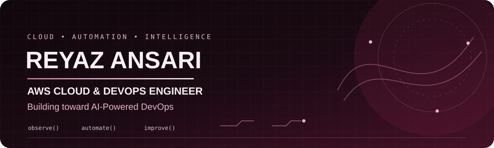

<!-- AI-focused GitHub profile README for Reyaz1 -->

  
  

    
    
  

  *Automate thoughtfully. Observe deeply. Use AI responsibly.*

---

## 👨‍💻 About Me

I'm a Cloud & DevOps engineer focused on improving how applications are built, deployed, monitored, and operated.

My long-term direction is **AI-powered DevOps**—using AI to help engineers investigate logs, understand incidents, and make safer operational decisions. I’m strengthening the fundamentals and working toward practical projects with clear documentation and verifiable results.

<strong>🧰 Technology focus</strong>

- ☁️ **Cloud & Infrastructure:** AWS, Linux, Terraform
- 📦 **Containers & Orchestration:** Docker, Docker Compose, Kubernetes
- 🔄 **CI/CD & GitOps:** Jenkins, GitLab CI/CD, GitHub Actions, Argo CD
- 📊 **Observability:** Prometheus, Grafana, CloudWatch
- 🐍 **Automation:** Python, Bash
- 🤖 **AI direction:** AI-assisted log analysis, incident investigation, MLOps, and LLMOps

## 🧭 My Roadmap

**AWS DevOps** → **DevOps with AI** → **AI-Powered DevOps** → **MLOps** → **GenAI / LLMOps**

## ✨ Featured Work

### DevOps Portfolio Flask App · In development

A Flask + MySQL portfolio application with Docker Compose, Jenkins pipeline configuration, health checks, tests, and a custom interactive interface.

The repository is currently private while I review its code, history, and readiness for public release.

### 🤖 AI-Powered DevOps · Planned project

My next project direction is an AI-assisted log investigation workflow:
- Parse and classify application or infrastructure errors
- Summarize likely causes with supporting log evidence
- Recommend troubleshooting steps for engineer review
- Keep remediation human-approved and auditable

> This is a planned project, not a completed production system.

## 🎯 What I'm Working Toward

- [ ] Build a documented, tested AI-assisted log analyzer
- [ ] Add structured outputs and evidence-linked incident summaries
- [ ] Evaluate results against sample logs and known expected outcomes
- [ ] Explore safe, human-approved remediation workflows
- [ ] Progress toward MLOps and GenAI / LLMOps fundamentals

## 🤝 Connect

- 💼 [LinkedIn — Reyaz Ansari](https://www.linkedin.com/in/reyaz-ansari1999)
- 🧑‍💻 [GitHub — Reyaz1](https://github.com/Reyaz1)

---

**Learn the fundamentals · Automate the repeatable · Use AI responsibly**

